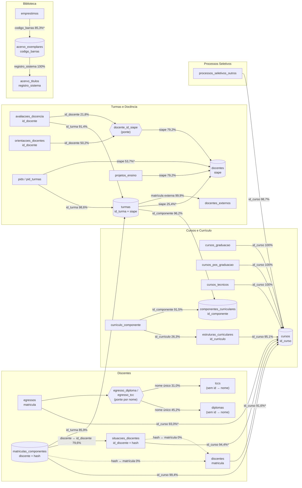

# Dados Abertos de Ensino da UFRN → SQLite

Coleta dos 24 datasets do grupo **ensino** do portal de dados abertos da UFRN
([dados.ufrn.br/dataset?groups=ensino](https://dados.ufrn.br/dataset?groups=ensino))
e consolidação em um banco SQLite único, com as tabelas ligadas por id (ou pela
melhor aproximação possível, quando a fonte não tem um id em comum).

## Pré-requisitos

- Python 3.10+
- ~3 GB de espaço livre para os arquivos baixados + ~5 GB para o banco final
  (~8 GB no total, durante a execução)
- Conexão com a internet (fala com `dados.ufrn.br`)

## Como executar

```powershell
# 1. Criar e ativar o ambiente virtual
python -m venv .venv
.venv\Scripts\activate

# 2. Instalar a unica dependencia do pipeline
pip install -r requirements.txt

# 3. Baixar os dados do portal (gera arquivos/ e manifesto.json)
python baixar.py

# 4. Construir o banco (gera ufrn_ensino.db)
python construir_banco.py
```

Ao final, `ufrn_ensino.db` está pronto para consultar (veja [Como abrir no
DBeaver](#como-abrir-o-banco-no-dbeaver) mais abaixo).

Observações:
- **`baixar.py` é idempotente**: um arquivo já presente em `arquivos/` é
  reaproveitado (aparece como `cache` no log). Pode rodar de novo a qualquer
  momento — só busca o que falta ou o que mudou de recorte.
- **`construir_banco.py` recria o `.db` do zero** a cada execução (apaga o
  arquivo anterior, se existir).
- O download de todo o histórico configurado soma **~2,8 GB** em ~290
  arquivos; a montagem do banco gera um arquivo de **~4,5 GB**. O processo
  completo (download + build) leva vários minutos — a etapa mais lenta é o
  `PRAGMA integrity_check`/`VACUUM` final sobre o banco já populado.
- O portal serve uma cadeia de certificados incompleta, então `baixar.py` usa
  `verify=False` ao falar com `dados.ufrn.br` (sem isso, toda requisição falha).

## Pipeline

```
baixar.py  →  construir_banco.py  →  ufrn_ensino.db
 (coleta)       (trata + carrega)
                     ↑
           parser_tolerante.py
         (usado só no passo acima,
          para 1 arquivo problemático)
```

| Script | Papel | Entrada | Saída |
|---|---|---|---|
| `baixar.py` | **Coleta.** Consulta a API CKAN do portal, decide quais recursos baixar por dataset (regra `RECORTE`, ver abaixo) e baixa com streaming/retry. | API `dados.ufrn.br` | `arquivos/dados/`, `arquivos/dicionarios/`, `manifesto.json` |
| `parser_tolerante.py` | **Tratamento.** Parser dedicado ao único CSV do grupo com HTML malformado (ver "Defeitos de origem"). Não é executado isoladamente — é importado por `construir_banco.py`. | `processos-seletivos-outros.csv` | função `parse()` |
| `construir_banco.py` | **Tratamento + carga.** Detecta encoding/separador, infere tipos, normaliza valores, corrige os defeitos de origem, cria tabelas-ponte e views, indexa. | `manifesto.json` + `arquivos/dados/` | `ufrn_ensino.db` |

## Estrutura do projeto

```
# versionado no git
baixar.py              coleta
parser_tolerante.py    tratamento (CSV malformado)
construir_banco.py     tratamento + carga
requirements.txt       dependencias (so 'requests')
.gitignore
README.md

# gerado ao executar (ignorado pelo git — ver .gitignore)
arquivos/
  dados/<dataset>/      CSV/JSON baixados
  dicionarios/           PDFs com a descrição de cada coluna
manifesto.json          metadados de tudo que foi baixado
ufrn_ensino.db           banco final
.venv/                   ambiente virtual
```

## O que foi baixado

Regra de recorte, configurada em `RECORTE` (`baixar.py`), por dataset:
- **`"tudo"`**: histórico completo disponível no portal.
- **`("desde", ano)`**: todo ano ≥ o indicado, com todos os semestres.
- **`"max"`** (padrão, para dataset não listado em `RECORTE`): só o
  ano/semestre mais recente.
- Dataset sem recorte temporal (cadastro) vem completo de qualquer forma.

A maioria dos datasets temporais está configurada para o histórico completo —
sai caro em linhas, mas é barato em volume de arquivo e maximiza as conexões
entre anos. A exceção é `matriculas-componentes`: é a maior tabela do banco, e
o histórico completo do portal (42 arquivos, 2007–2026) quase dobraria o que
foi baixado; optou-se por uma janela de 10 anos.

| Dataset | Recorte baixado | Observação |
|---|---|---|
| matriculas-componentes | **2016–2026** (24 arquivos, `desde 2016`) | janela de 10 anos — histórico completo do portal vai até 2007 (42 arquivos) |
| turmas | **2000–2025** (54 arquivos, `tudo`) | |
| emprestimos-acervos-das-bibliotecas | **2000–2026** (52 arquivos, `tudo`) | |
| discentes | **1990–2026** (37 arquivos, `tudo`) | ingressantes |
| egressos | **2006–2025** (20 arquivos, `tudo`) | |
| situacoes-de-discentes | **2009–2026** (36 arquivos, `tudo`) | |
| orientacoes-docentes | **2005–2020** (16 arquivos, `tudo`) | série parada no portal em 2020 |
| planos-individuais-docentes | **2009–2021** (26 arquivos, `tudo`) | JSON; série parada no portal em 2021 |
| avaliacoes-de-docencia | arquivo único | já contém a série 2013–2026.1 |
| demais 15 datasets | cadastro completo | cursos, docentes, componentes curriculares, acervo, diplomas, TCCs, etc. — **são o estado ATUAL**, não histórico (ver "Limites conhecidos") |

Procedência completa (dataset, recurso, URL, bytes) em `manifesto.json` e na
tabela `_fontes` do banco. Volume baixado: **287 arquivos, 2,8 GB**.

## Defeitos de origem corrigidos na carga

**1. `processos-seletivos-outros.csv` tem HTML colado do Word, com aspas duplas
não escapadas e quebras de linha dentro dos campos.** Nenhum parser CSV
convencional o lê: o leitor padrão fragmenta 6.266 registros em 130.429
pedaços. `parser_tolerante.py` ancora cada registro por regex (todo registro
começa com `"<id>";` no início da linha) e extrai os campos de ambas as pontas
— resultado: 6.266 registros, 96% com parse completo, `nome_curso` sem nenhuma
contaminação de HTML. Os dois campos de edital (meio do registro) não têm
delimitador confiável entre si e ficam concatenados em `edital_html_bruto`.

**2. `docentes_externos.matricula_docente_externo` chega com aspas dentro do
valor** (`'"10001"'` em vez de `'10001'`). Isso zerava o join com `turmas`.
Corrigido com `TRIM(..., '"')` → join sobe para 4.162 de 4.166 (99,9%).

**3. `turmas` e `avaliacoes_docencia` não têm uma linha por turma, e sim por
turma×docente** (há turmas com até ~90 docentes; fan-out médio de 1,58× sobre
o histórico completo). Juntar `matriculas` direto com `turmas` multiplicaria
as matrículas no mesmo fator. As views agregam para 1 linha por turma antes de
juntar (`vw_turma_info`, `vw_avaliacao_turma`) — use-as em vez das tabelas
cruas para evitar esse fan-out.

Também: 7 `componentes_curriculares` apareciam duplicados entre arquivos de
modalidade com ementa idêntica; duplicatas removidas.

## O banco: `ufrn_ensino.db`

**32 tabelas de dados + 10 views + 44 índices, 23.078.229 linhas, 4,5 GB**
(`PRAGMA integrity_check` = ok). Os tipos de coluna são declarados no
`CREATE TABLE`, de modo que a type affinity do SQLite converte os ids para
inteiro — é isso que faz os joins casarem entre tabelas.

### Diagrama de relações entre as tabelas

Diagrama [Mermaid](https://mermaid.js.org/) — renderiza nativamente no GitHub,
GitLab e no VS Code (extensão *Markdown Preview Mermaid Support*). Os rótulos
das setas trazem a coluna de ligação e a cobertura real medida (% de valores
da origem que encontram correspondência no destino).



Legenda: ⬭ (cilindro) = tabela-dimensão central; ⬡ (hexágono) = tabela-ponte
derivada (`docente_id_siape`, `egresso_diploma`/`egresso_tcc`); seta
pontilhada = ligação quebrada (anonimização por hash, sem solução possível).
`*` = ligação limitada pelo fato de o destino (`cursos`/`docentes`/
`acervo_exemplares`) ser um **cadastro do presente**, não um registro
histórico — ver "Limites conhecidos".

### Tabelas principais

| Tabela | Linhas | Chave |
|---|---|---|
| `matriculas_componentes` | 14.935.289 | `id_turma`, `discente` (hash), `id_curso` |
| `emprestimos` | 3.239.090 | `codigo_barras`, `matricula_ou_siape` |
| `situacoes_discentes` | 1.365.411 | `id_discente` (hash), `id_curso` |
| `turmas` | 561.377 | `id_turma` + `siape` (1 linha por turma×docente) |
| `acervo_exemplares` | 626.251 | `id_exemplar`, `codigo_barras` |
| `acervo_titulos` | 262.067 | `registro_sistema` |
| `discentes` | 410.109 | `matricula`, `id_curso` |
| `pid_turmas` | 190.708 | `siape`, `id_turma` |
| `egressos` | 127.893 | `matricula`, `id_curso` |
| `avaliacoes_docencia` | 205.908 | `id_turma` + `id_docente` + `ano`/`periodo` |
| `curriculo_componente` | 113.554 | `id_curriculo`, `id_componente_curricular` |
| `diplomas` | 99.768 | — (sem id; liga por nome via `egresso_diploma`) |
| `tccs` | 93.236 | — (sem id; liga por nome via `egresso_tcc`) |
| `componentes_curriculares` | 48.310 | `id_componente` |
| `egresso_diploma` | 57.837 | ponte `egressos` ↔ `diplomas` (nome único) |
| `egresso_tcc` | 39.610 | ponte `egressos` ↔ `tccs` (nome único) |
| `pids` | 31.878 | `siape` |
| `orientacoes_docentes` | 15.598 | `id_docente` |
| `cursos` | 1.521 | `id_curso` |
| `docentes` | 2.865 | `siape` |
| `docente_id_siape` | 1.450 | ponte `id_docente` (SIGAA) ↔ `siape` |

Mais: `docentes_externos`, `estruturas_curriculares`, `cursos_graduacao`,
`cursos_pos_graduacao`, `cursos_tecnicos`, `programas_pos_graduacao`,
`processos_seletivos_graduacao`, `processos_seletivos_outros`,
`projetos_ensino`, `acervo_exemplares_v1` (versão anterior do acervo, mantida
para conferência), `_fontes` (procedência de cada arquivo carregado).

### Views (use estas para evitar fan-out)

| View | Granularidade | Para quê |
|---|---|---|
| `vw_matriculas_completa` | 1 por matrícula | matrícula + turma + componente + curso |
| `vw_turmas_completa` | 1 por turma | turma + componente + avaliação + nº de matrículas |
| `vw_turma_info` | 1 por turma | turma com docentes agregados |
| `vw_turma_docente` | 1 por turma×docente | docente interno e externo unificados |
| `vw_avaliacao_turma` | 1 por turma/semestre | médias da avaliação de docência |
| `vw_avaliacoes_docencia` | 1 por avaliação | avaliação + siape resolvido pela ponte |
| `vw_discente_hash` | 1 por situação | trajetória do discente anonimizado |
| `vw_egressos_completo` | 1 por egresso | egresso + diploma + TCC resolvidos pela ponte por nome |
| `vw_emprestimos_acervo` | 1 por empréstimo | empréstimo + título/autor do acervo |
| `vw_estrutura_componentes` | 1 por componente do currículo | matriz curricular montada |

### Limites conhecidos (é a fonte, não a carga)

- **`cursos`/`docentes`/`acervo_exemplares` são o estado ATUAL, não um
  registro histórico.** São cadastros vivos: cursos descontinuados saem de
  `cursos`, servidores que se desligaram saem de `docentes`, exemplares
  baixados saem de `acervo_exemplares`. Qualquer tabela de fato que cubra
  décadas (`turmas`, `pids`, `discentes`, `egressos`, `situacoes_discentes`,
  `emprestimos`) vai ter uma fração de registros antigos que não encontram
  mais correspondência nesses cadastros — não é erro de join, é o `id_curso`/
  `siape`/`codigo_barras` referenciar algo que não existe mais hoje:
  - `turmas.siape → docentes`: **25,4%** — a maioria das turmas antigas foi
    lecionada por docentes já aposentados/desligados.
  - `pids.siape → docentes`: **53,7%** (mesmo motivo).
  - `discentes/egressos/situacoes_discentes.id_curso → cursos`: **91–94%**
    (cursos extintos ao longo das décadas).
  - `emprestimos.codigo_barras → acervo_exemplares`: **85,3%**
    (exemplares baixados do acervo ao longo de 26 anos de empréstimos).
  Não há correção possível sem o portal publicar snapshots históricos dessas
  três tabelas — não existem hoje.
- **`id_turma` é sequencial por semestre, então o ano da fonte importa.**
  `turmas` cobre 2000–2025 e `matriculas_componentes` 2016–2026; o join casa
  **85,9%** — o resto é essencialmente as matrículas de 2026, ano que
  `turmas` ainda não publicou. `avaliacoes_docencia` e `pid_turmas` casam
  **91,4%** e **98,6%** com `turmas`, já que ambos caem dentro do range
  2000–2025.
- **Discentes têm dois identificadores que não se cruzam**: `discentes.matricula`
  é a matrícula real; `matriculas_componentes.discente` e
  `situacoes_discentes.id_discente` são um **hash anonimizado**. Não há join
  possível entre os dois mundos — é anonimização da fonte, testada e
  descartada (nem MD5/SHA1/SHA256 da matrícula reproduz o hash). Entre si,
  porém, `matriculas ↔ situacoes_discentes` casa **79,6%**.
- **Docentes têm dois identificadores que quase não se cruzam**: SIAPE
  (`docentes`, `turmas`, `pids`) vs. id interno do SIGAA (`avaliacoes_docencia`,
  `orientacoes_docentes`, `cursos.id_coordenador`). `projetos_ensino` é a única
  tabela que traz os dois lado a lado (relação 1:1); dela vem a tabela-ponte
  `docente_id_siape` (1.450 pares). Cobre 21,8% das avaliações e 50,2% das
  orientações — é o teto do que os dados publicados permitem.
- **`diplomas` e `tccs` não têm nenhum id — só o nome do formando em texto
  puro.** Diferente de `matriculas_componentes`/`situacoes_discentes`,
  `egressos.nome_discente` não é hash, então dá para casar por nome. As
  pontes `egresso_diploma`/`egresso_tcc` só guardam pares com **nome único
  nos dois lados** (sem risco de homônimo — 18,8%/26,2% dos nomes em
  `diplomas`/`tccs` se repetem), cobrindo **45,2%**/**31,0%** dos 127.893
  egressos (**57.837**/**39.610** pares em termos absolutos — o número a
  olhar quando o interesse é alcance, não taxa). `discentes` (ingressantes)
  não ganhou ponte equivalente: a maioria ainda não colou grau, cobertura
  baixa e pouco útil — **`egressos` é o ponto de entrada certo para
  relacionar discente a diploma/TCC.**
- À parte do join: **72,7% das 99.768 linhas de `diplomas` têm
  `numero_diploma` vazio** na própria origem (diploma ainda não expedido/
  registrado) — não é perda do join, é lacuna do dado-fonte.
- `curriculo_componente → estruturas_curriculares` cobre 26,3%:
  `estruturas_curriculares` é um snapshot dos currículos vigentes (473),
  enquanto `curriculo_componente` guarda currículos históricos (1.760).

---

## Como abrir o banco no DBeaver

1. **Instale o DBeaver** (Community Edition, gratuito) se ainda não tiver:
   [dbeaver.io/download](https://dbeaver.io/download).

2. Abra o DBeaver e clique no ícone de **tomada com um "+"** na barra superior
   (ou menu **Database → New Database Connection**).

3. Na lista de tipos de banco, escolha **SQLite** → **Next**.

4. No campo **Path**, clique em **Browse** e selecione o arquivo
   `ufrn_ensino.db`, na raiz do projeto.

5. Clique em **Test Connection**.
   - Na primeira vez, o DBeaver avisa que falta o driver JDBC do SQLite e
     oferece **Download**. Clique em **Download** e aguarde — é automático,
     não precisa baixar nada manualmente.
   - Depois do download, clique em **Test Connection** novamente: deve
     aparecer "Connected".

6. Clique em **Finish**.

7. No painel **Database Navigator** (lado esquerdo), expanda:
   `ufrn_ensino` → `Databases` → `main` → **Tables** (32 tabelas) e
   **Views** (10 views).

8. Para consultar, clique com o botão direito na conexão → **SQL Editor →
   New SQL Script**, e rode qualquer `SELECT`. Exemplo para testar:
   ```sql
   SELECT periodo_referencia, COUNT(*) AS matriculas, COUNT(DISTINCT id_turma) AS turmas
   FROM vw_matriculas_completa
   GROUP BY periodo_referencia;
   ```

> Dica: o arquivo tem **4,5 GB** e `matriculas_componentes` tem quase 15
> milhões de linhas — nunca abra o botão de "visualizar dados" dessa tabela
> (ou de `emprestimos`, `situacoes_discentes`, `turmas`) sem um `WHERE`/`LIMIT`,
> o DBeaver tenta contar todas as linhas da grid por padrão e pode travar a
> interface por um bom tempo.
